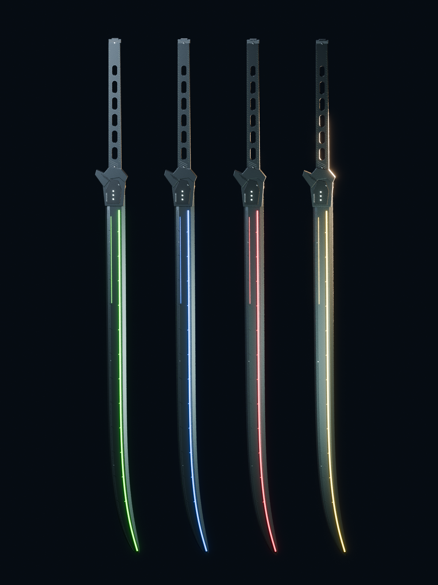

# DINOCA 3Dモデル

リファレンス画像をもとに作成した3Dモデルです。寸法・裏面は推定で補完しています。

## ダウンロード

[DINOCA_3D_Model_FBX_OBJ.zip をダウンロード](https://github.com/tsuna12356/-/raw/refs/heads/main/DINOCA_3D_Model_FBX_OBJ.zip)

緑・青・赤・黄のFBXとOBJ、MTL、Blender編集データ、プレビュー、日本語説明書を同梱しています。

ZIPを展開し、OBJと同名のMTLは同じフォルダに置いてください。発光の表示は読み込み先の設定によります。

